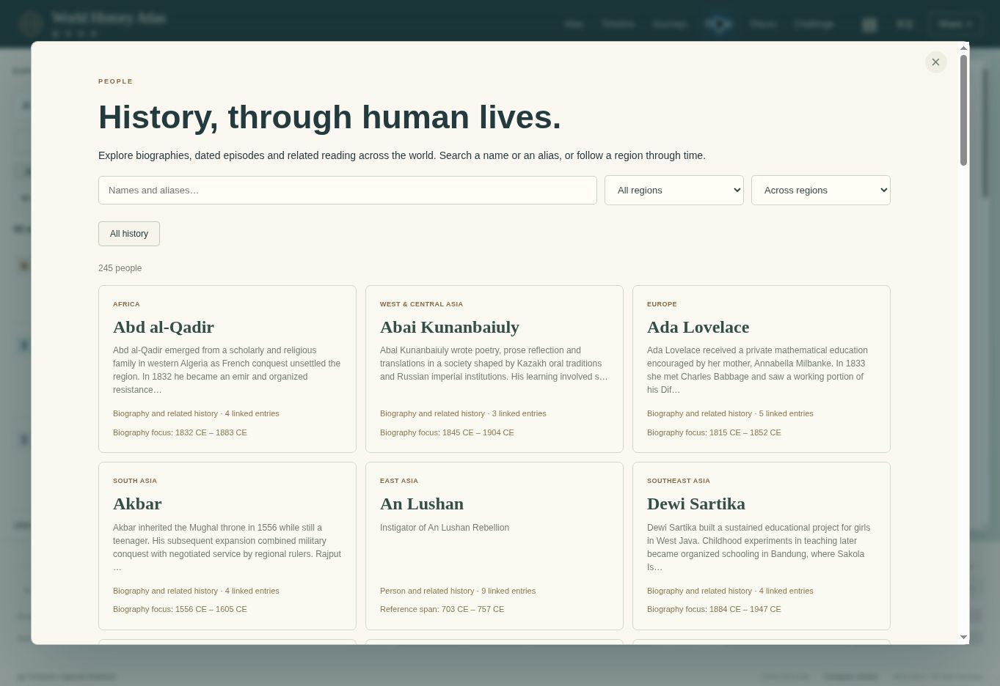

# V10 verification · 23 October 2026

Application **0.9.0**, continuing the complete V9 source at GitHub commit `2dbb2ab4b87f326946562325801499886dca14a8`. This document records checks on the V10 publication source and the managed preview. A passing source check is distinct from a successful GitHub update or Site deployment; the final delivery message supplies those receipts and their exact commit/version identifiers.

## Accepted source inventory

| Measure | V9 baseline | V10 addition | V10 total |
| --- | ---: | ---: | ---: |
| Selectable atlas records | 1,713 | 96 | 1,809 |
| Narrative biographies | 105 | 39 | 144 |
| Dated biography milestones | 259 | 159 | 418 |
| Shared People identities | 206 | 39 | 245 |
| Political overviews | 161 | 0 | 161 |
| Reading paths | 55 | 0 new path IDs | 55 |

The 96 additions cite **168 distinct URLs**. The validator reports **1,600 distinct cited pages** across the full narrative and map corpus; some V10 URLs were already cited, so these two source counts are not additive. People identities include inherited source profiles as well as narrative biographies, with existing confirmed identity merges retained.

All 32 regional expansion reading-path IDs and their prior record references survive. **26 paths gain additional records**; the other six are retained. The remaining 16 study guides and seven guided readings are unchanged. The atlas therefore has 48 study guides and seven guided readings in total.

Final region totals are Africa 117; West and Central Asia 93; Europe 106; South Asia 78; East Asia 1,088; Southeast Asia 90; North America 78; Latin America 82; Oceania 77. The East Asia total includes the preserved China collection; its seven V10 additions concern Japan and Korea.

## Automated checks actually run

`npm run build:content` regenerated the cumulative V10 manifest and reading paths. The final `npm run check` completed with **154 tests passing, zero failures, zero skipped tests**, after the last biography chronology correction. All 149 baseline tests remain, with five V10 integration tests added. A separate integration review also ran the 13 discovery and V10 tests successfully.

The V10 gates establish:

- Frozen V9 expansion-file descriptors, byte counts and SHA-256 hashes are retained; the new manifest adds four separately accounted regional files. No record ID collides with the loaded base, expansion or China collections.
- Every new record has English and Chinese narrative/date/evidence-scope fields, source retrieval metadata and at least two resolvable related record IDs. Every new biography has at least three dated, chronological milestones within its declared focus interval.
- All 39 new biographies enter shared Atlas and People discovery, including unaccented name aliases where added. Curated forward and reverse related-record links reach the People directory alongside supported textual mentions.
- Existing confirmed China biography/profile identity merges remain intact. Prior reading-path IDs and stops remain valid; V10 records appear in their declared workstream paths.
- Shared URL state resolves new records and biography focus. Non-polity additions remain outside the political timeline bars.
- Negative audit fixtures reject missing bilingual review limits, invalid related links, out-of-range or reversed biography milestones and inappropriate political-timeline metadata.

The retained suite also checks civil chronology without year zero, immutable China imports and review overlays, route and notebook behavior, dated map selection, modern transitions, geometry winding and holes, historical colour conventions, and timeline eligibility and packing. The validator continues to report **975 mapped China events**, **104 source profiles**, six reviewed events and 24 chronicle annotations; **15 route collections / 126 stops**; **43 original global checkpoints / 516 historical territory instances / 180 polity identities**; and **242 contemporary reference units**.

No V10 change adds political shapes, boundary dates, mapped routes or water geometry. Existing geometry and China import checks therefore protect the retained behavior rather than certify new historical mapping.

## Browser checks actually performed

The managed preview served the publication source's `dist/` files. The desktop viewport was **1363 × 936**. A temporary, preview-only harness also loaded the same application in a **390 × 844 CSS-pixel iframe**. The harness was removed before packaging. This is a responsive-layout check, not a claim of physical-device testing.

| Check | Observed result |
| --- | --- |
| Full application load | The shared footer shows **1,809 entries**, nine regions and **161 political overviews**. |
| English biography search and map navigation | Searching Ada Lovelace opens the new biography; choosing her 1843 publication milestone updates the map year to 1843 and selects the corresponding life step. |
| Chinese biography display | Ada's translated narrative, chronology, life steps, evidence qualification and related reading display correctly. |
| People directory inventory | The directory shows **245 people**, with biographies and inherited source profiles in one regional browsing flow. |
| Unaccented name search | `Nguyen Thi Binh` returns Nguyễn Thị Bình with four linked entries; her person page displays the biography link and three curated contextual records. |
| Existing/new related reading | Ada's detail exposes linked Newton, Turing, Bletchley and web-history records. The People integration uses the same relationship helper as record details. |
| Reading library | The Journeys panel exposes **55 guided-reading choices**. The modern East Asia regional guide has **20 stops**, including new Tsuda, Tomioka, Kim Gu, Park Du-seong, Chiri and exile-institution entries. |
| Reading-step navigation | Selecting stop 13 opens Chiri Yukie; Next opens the existing March First movement entry. The URL retains `course-expansion-ea3` and its updated step. |
| Narrow English and Chinese detail | Chiri's title, narrative, dates and three life milestones remain readable in both languages. The usable body width and scroll width both measured **375 px**; the detail panel measured **359 px**. |
| Corrected life endpoint | Chiri's selectable life ends in **1922**. The sourced 1923 posthumous publication remains in prose, outside the life navigation. |

An early browser refresh exposed a cached V9 content module that lacked the new manifest export. The changed app, content-expansion and discovery modules now use `v=10` asset URLs, and the final refresh loaded the V10 collection successfully. This was an observed compatibility fix, not an inferred performance improvement.



The screenshot records the local publication candidate. Public deployment is checked separately after publishing.

## Evidence review and editorial corrections

The four regional research ledgers document source URLs, claim fit, date interpretation, access limits and held material:

- [Africa and West/Central Asia](V10_AFRICA_WEST_ASIA_RESEARCH.md)
- [South, East and Southeast Asia](V10_ASIA_RESEARCH.md)
- [The Americas and Oceania](V10_AMERICAS_OCEANIA_RESEARCH.md)
- [Europe](V10_EUROPE_RESEARCH.md)

Cross-review of the regional additions resolved concrete chronology and wording issues. Examples include removing an unsupported dated Dewi Sartika step; keeping Mabo's posthumous court outcome, Sālote's repatriation and Chiri's posthumous publication out of personal-life navigation; distinguishing Winnemucca's Vancouver petition from a separate Paiute petition; qualifying the territorial result of the First Punic War; and avoiding wording that implied the Analytical Engine was later completed. Chinese names and institutional chronology were also corrected where the review found specific issues.

Review notes distinguish inspected text, catalogue evidence, abstracts and indexed-only evidence. The Philippine suffrage outcome statement remains explicitly indexed-only after a body-access failure; the enabling act was inspected directly. Sources from one institution are not represented as independent corroboration. Primary documents establish their authors' statements or prescriptions, with implementation assessed separately where the evidence supports it.

This work used direct source research and editorial synthesis. No external GPT Pro, Gemini or other research-service report is claimed as evidence for V10. The older research handoff remains available and is marked with the current continuation status.

Tests verify inventory, structure and application behavior. They do **not** establish historical truth, specialist translation review, representative global coverage, exact travel tracks or reconstructed annual borders. The non-China collection is deeper after V10 but remains substantially less dense than the inherited China chronology. See [release scope and remaining priorities](V10_RELEASE.md) and [next steps](NEXT_STEPS.md).

## Delivery and reproduction

The canonical source destination is [`world/` on `world-history-atlas`](https://github.com/haitaowu12/jiangshan-map/tree/world-history-atlas/world). The original project outside `world/` remains outside this release's changes. The existing public destination is the [World History Atlas](https://world-history-atlas-tony.techiesea.chatgpt.site).

Publication uses the following acceptance sequence: finish the checks above; synchronize the complete `world/` source into the existing standalone Site checkout; compare file contents; push the exact source state; package the configured static output; save and deploy that Site version; then verify the GitHub branch and live application. GitHub's final tree is compared with the complete local project, not just the changed files. A failed or pending hosting response is not reported as successful publication.

The source checks can be reproduced with Node.js 22 or later, without installing dependencies:

```sh
npm run build:content
npm run check
```

`build:content` updates the derived V10 manifest and course file; it does not rewrite the frozen V9 inputs. The application remains a static `dist/` deployment with its existing hosting configuration.
