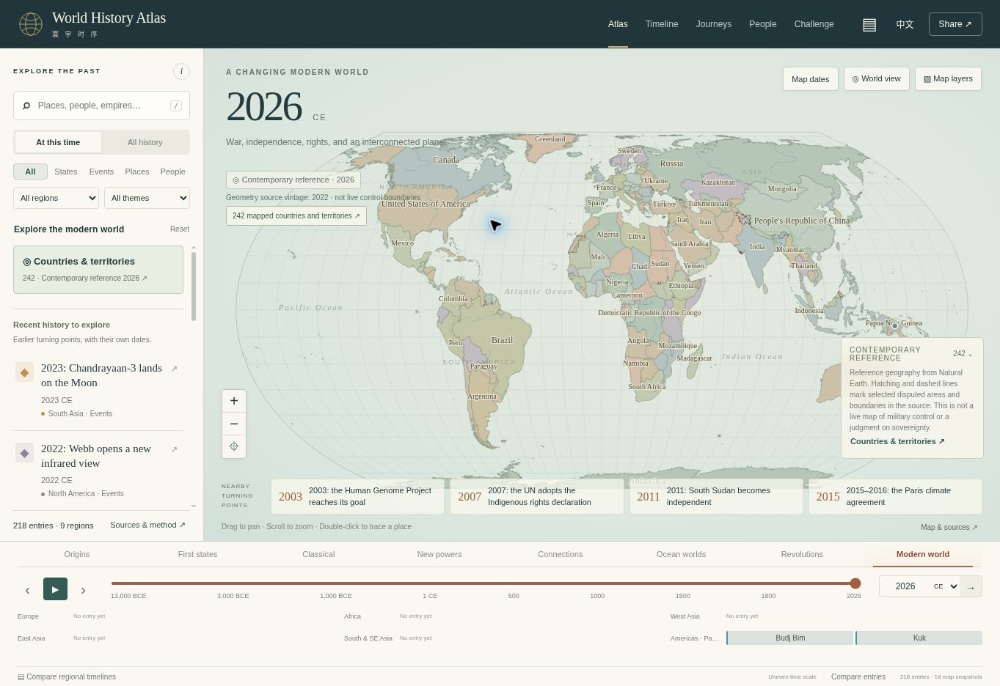

# V3 verification — chronology and the contemporary world

> **Earlier release: V3 (version 0.3.0).** The behavior, counts and results below are retained as a historical verification record. V4 supersedes the exact-year-only display rule with reviewed map context. See [V4 verification](V4_VERIFICATION.md) and the [current README](../README.md).

Reviewed 22 October 2026. This report records checks on application version 0.3.0. It supersedes the v2 acceptance report for the files changed in this revision. It is not a claim that every historical boundary or narrative is complete or independently verified.

## Problem and correction

The previous renderer selected the latest territory snapshot at or before the requested year. With 1960 as the latest available map, the Soviet Union and divided Germany could remain visible in 2026. The same fallback could carry earlier imperial outlines across major political changes.

Historical territory rendering and `atlasAPI.inspect` now require an exact source-year match. Between documented map dates, the app retains the requested story year, displays physical geography without inherited political polygons, and offers links to available map years. The optional previous-snapshot comparison is confined to historical maps and explicitly dated. A separate contemporary reference is available only at its stated review year, currently 2026; its 2022 source geometry vintage remains visible.

The new Map dates chooser exposes all 18 historical source years and the contemporary reference. Country selection, the searchable directory, English/Chinese labels and shared country links use the contemporary collection explicitly.

## Data delivered

| Collection | V3 state |
| --- | --- |
| Combined entries | 218: 194 historical entries and 24 biographies |
| New history entries | 26 finite events, with 53 distinct evidence URLs |
| Biographical milestones | 75 |
| Historical maps | 18 dated snapshots; 245 territory instances; 99 polity IDs |
| New historical checkpoints | 1994: 47 selected territories; 2000: 47; 2010: 48 |
| Contemporary reference | 242 mapped countries and territories; not a sovereign-state count |
| Selected dispute overlays | 25 hatched claim areas and 29 lines |
| Reading paths | 7 guided readings and 9 study guides |
| Routes/networks | 8 collections, 58 stops and 51 connections |

The new historical narratives distinguish formal dates from nearby events: German reunification from the opening of the Berlin Wall; Vietnam's formal union from the end of the war; and South Sudan's independence from UN admission. New paths explain how separation, union, independence and recognition affect map interpretation. See [modern history research](MODERN_HISTORY_RESEARCH.md).

Three erroneous older features were removed: the 1800 Peru and Río de la Plata polygons misallocated Upper Peru, and the 1900 Ethiopia polygon omitted Harar. Their exclusions and evidence remain documented in [the temporal audit](TEMPORAL_AUDIT_V3.md) and map metadata. Old Nagorno-Karabakh/Artsakh and Donetsk/Luhansk control overlays are excluded from the contemporary reference. Palestine's display category is UN observer State; the imported source classification remains provenance only.

## Automated verification

`npm run check` passes structural validation and **53 tests**. JavaScript syntax and `git diff --check` also pass. The validator reports 374 distinct source-page URLs in its checked corpus. These counts describe included evidence, not the number of independently verified historical claims.

The temporal suite tests every unsupported civil year from 13,000 BCE through 2026 CE, with no invented year zero, and confirms that none inherits a historical outline. It checks exact historical dates, the contemporary review-year contract, navigation between available maps and known political-transition gaps.

Contemporary regressions verify all 15 former Soviet republics as separate map units; actual Russia geometry containing Moscow but excluding Kyiv, Almaty and Riga; South Sudan separate from Sudan; Bangladesh separate from Pakistan; and the absence of retired Cold War labels. The 1994, 2000 and 2010 checkpoints contain neither the USSR nor divided Germany and do not introduce South Sudan before independence. Dispute tests retain the Crimea hatch while excluding obsolete control overlays. An additional test protects Palestine's observer-State category, translations and UN citation.

All 242 contemporary country features and 25 claim-area features were checked for finite projected paths in three D3 projections. The 142 new historical feature instances were compared with CShapes state existence and representative interior points at the documented years. This comparison does not establish vertex accuracy or rule out every territorial omission. CShapes geometry is not redistributed. Details are in [MODERN_MAP_VALIDATION.json](MODERN_MAP_VALIDATION.json).

## Browser verification

The app was exercised in Chromium through the local managed preview. Checks included:

- 1960 displays its historical USSR and East/West Germany. 1994 displays Russia, unified Germany, Czech and Slovak states. 2026 renders 242 contemporary polygons with no obsolete state labels and no historical ghost outlines.
- A 1972 gap contains zero political polygons and zero historical ghosts, keeps the selected year, and offers actual 1960/1994 map links.
- The map-date chooser opens the intended year and reports the correct collection counts and source vintage.
- A shared Russia URL restores the country panel and its source notes. It also restores the required political layer after the visitor has previously disabled that layer.
- The modern-map reading path opens actual event years, including Singapore in 1965 and reunification in 1990, without carrying 1960 borders into those years.
- The country directory finds Türkiye from the Chinese query `土耳其`; selection opens the correct country panel.
- Responsive frames at 390 px and 320 px were inspected in English and Chinese. Their document widths did not exceed their available widths. The map projection was adjusted to keep the source/date explanation above the mobile overview.

No application-origin warnings or errors were returned by the console check for the managed-preview origin. Browser-extension metadata errors were excluded from that application check. This was not a Safari, physical-device, assistive-technology or full accessibility certification.

## Remaining limits

The contemporary reference is reviewed for the 2026 experience but uses Natural Earth's pinned 2022 map geometry. It is not a live conflict/control map. Its small-scale outlines, dependencies and disputed areas require their source notes; a neutral hatch does not resolve a sovereignty dispute. Read [contemporary map methodology](CONTEMPORARY_MAP_METHODOLOGY.md).

Historical coverage is selective, and exact-year selection exposes large gaps. The next expansion should add researched checkpoints around major transitions and improve regional depth, rather than infer unchanged borders from a state's lifespan. The dated stories remain available between maps. See [the next priorities](NEXT_STEPS.md).

This report records source and browser verification. Publication should be verified separately against the pushed source commit and the deployment service's terminal result.
