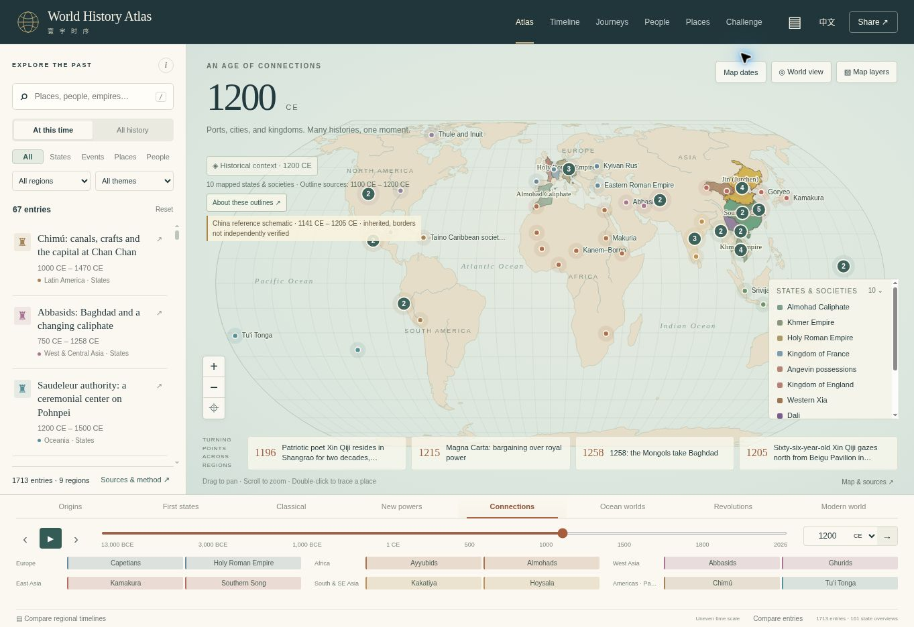
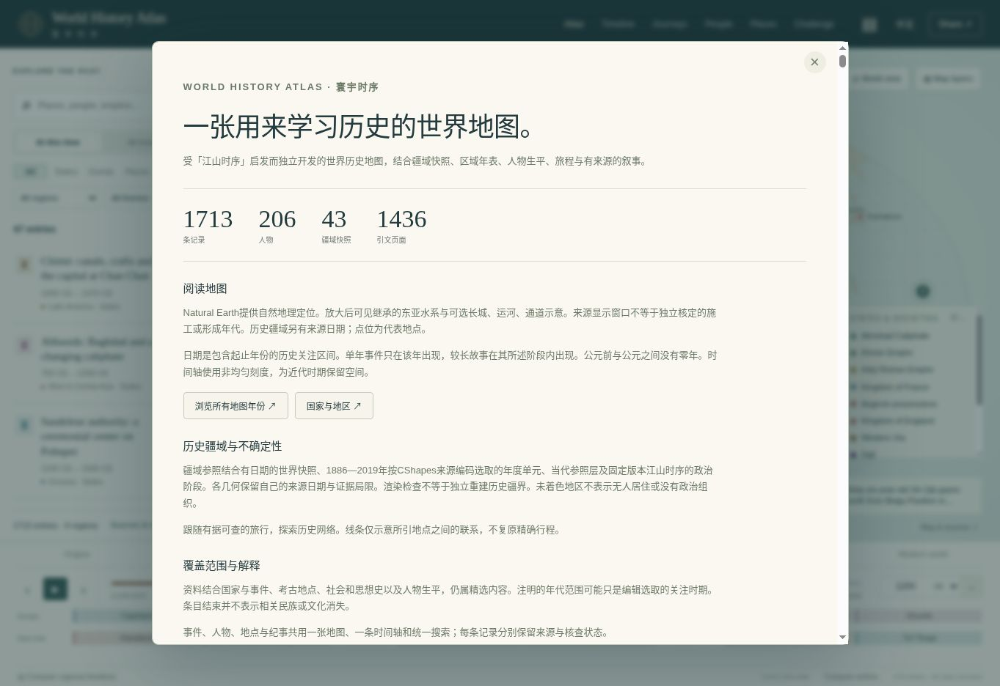

# V9 verification · 23 October 2026

Application 0.8.0. This record describes the release candidate prepared for the existing public Site. The source package is built from a verified pushed commit by the Sites workflow; deployment success is separately established by the hosting response. A passing test is not a deployment receipt.

## Automated checks

`npm run check`: structural validator passes; **149 tests pass, zero fail**. `node --check dist/app.mjs` also passes. The final packaging workflow reruns the required check on the publication source.

The tests cover civil chronology without year zero; immutable China input hashes and completeness; existing source geometry and modern transitions; spherical winding of all 5,081 territory/administrative features; Taiwan/mainland display colour; timeline polity eligibility and lane packing; discovery, notebook and route integration. The six V9 tests add exact expansion-file byte/hash accounting, all 32 roadmap workstreams and three releases, all bilingual reading-path/share references, new People integration including the confirmed Li Qingzhao identity link, major versus secondary timeline priority, water/corridor date boundaries and line geometry, and the two replacement subjects for the held Galle/Melaka conflation.

The older full-atlas integration assertion was updated to include manifest-listed expansion files rather than retaining its obsolete 1,369-record total. It continues to check the original source import and review overlay counts.

Final validator inventory: 1,713 records in nine regions; 1,436 distinct cited URLs across the whole inherited and new corpus; 105 full biographies and 259 milestones; 15 mapped route collections / 126 stops; 48 study guides plus seven guided readings; 43 original global source checkpoints / 516 historical shapes; 242 contemporary reference units. China retains 975 mapped event records, two merged source rows and one held raw row; six event reviews and 24 chronicle annotations. V9 separately restores 187 river paths, 62 lake edges, 41 water labels and 16 source corridor lines.

Counts and hash checks establish inventory and integrity, not factual correctness, independent source corroboration, historical border accuracy or translation expertise. No global completeness percentage is assigned.

## Browser checks actually performed

The managed local preview served the actual `dist/` files. Desktop view was inspected at the browser's 1363 × 936 viewport. A temporary test harness loaded the same app in 390 × 844 and 768 × 844 iframes; it was removed before packaging. At the mobile frame's usable width, body width and scroll width both measured 375 px. These are iframe responsive checks, not tests on physical devices.

- Loaded all added data with the shared count of 1,713 visible and no atlas initialization failure. Only an unrelated browser-extension metadata error appeared in the checked console output.
- Inspected the 1200 map and intermediate 1120/1410 source stages. Political fills remained regional; source dates and inherited-stage qualifications were visible. These observations supplement, rather than replace, the all-layer winding regression.
- Compared the political timeline's key and all-state modes at 1200: 77 versus 83 candidate overviews in the 900–1500 window. Expansion controls disclose omitted bars. Events, people and places remain outside the bars. The mobile Chinese timeline exposes readable controls and its own horizontal scrolling area.
- Searched for Galle, opened the separate corrected inscription and Melaka links, and verified English/Chinese narrative, qualified date, representative location, citation access notes and related reading.
- Opened Song rice in Chinese, checked its agricultural/social narrative and sources, and zoomed into China. At 1120 the DOM contained 240 active water paths, 33 labels and six corridor paths. Activated the Tongji Canal corridor with Enter and read its inherited source span and evidence warning.
- Opened the shared People directory: 206 identities were visible, including the new biographies. Data tests separately verify every new person reaches that index and Li Qingzhao's source profile maps to the new biography.
- Opened Journeys and the 55 thematic reading choices (seven guided readings plus 48 study guides). Opened the ten-entry Great Lakes/Congo path in Chinese and checked chronological stops, questions and activity. The About panel exposes all 32 regional path buttons and the final regional inventory.
- Refreshed the final candidate and saved the inventory and map screenshots below. These screenshots show the local candidate, not an independent crawl of the public deployment.

## Evidence review and remaining limits

See [implemented scope and evidence decisions](V9_RELEASES_IMPLEMENTED.md), the seven regional research registers and [critical cross-region samples](V9_CROSS_REGION_REVIEW.md). Primary institutional/scholarly pages, indexed excerpts and access failures are distinguished individually. Some source pairs are from the same institution, and some institutional texts contain conflicting or mistaken dates; specific conflicts remain qualified.

Gemini Pro, Argon High and Deep Research were selected and the signed-in service accepted two research requests. Both remained at generating a research plan and returned no usable report during release preparation. No Gemini findings were incorporated. The independent research and the source-access limits support this publication.

No new source-backed premodern political polygons outside the retained map datasets were created. Restored river/corridor windows are inherited reference windows, not independently established annual watercourses or engineering dates. The full inherited event/profile corpus is not independently corroborated by the bounded review. The external GitHub mirror was V2 at publication time; the owner subsequently requested the complete source synchronization and GPT Pro handoff, recorded in the delivery document.
